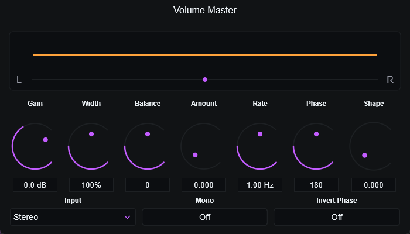

<h1 align="center">MaXXXtudio</h1>

<p align="center">
  Estação de trabalho de áudio digital para criar, organizar, editar e mixar música.
</p>

MaXXXtudio é um DAW open source desenvolvido em C++20 e JUCE 8.0.15. A plataforma principal
é Windows 10/11, com verificações automáticas também realizadas em Linux. O projeto combina
um view Arrangement, edição MIDI, hospedagem de VST3, mixer, automação e ferramentas nativas
em uma interface própria.

## Interface atual

<p align="center">
  
</p>

A captura mostra o Arrangement, o navegador de plugins e o Mixer, com faders, pan e meters L/R
por canal. A tela principal também oferece o Piano Roll, o navegador de áudio e a cadeia de
dispositivos. Pressione `F11` para entrar ou sair do modo tela cheia.

### Reposicionando uma janela de plugin

Este trecho curto mostra apenas como arrastar a janela de um plugin para a direita,
mantendo o Arrangement visível; não é uma demonstração completa do MaXXXtudio.
O GIF é uma prévia; clique nele para abrir o vídeo original.

<p align="center">
  <a href="app/assets/readme/demo.mp4">
    
  </a>
</p>

## Recursos implementados

- **Arrangement:** trilhas MIDI e áudio, múltiplos clips, mover/copiar/duplicar, divisão,
  grade adaptativa, locators, loop, visão geral, recolhimento de trilhas e transporte.
- **Piano Roll:** criar e editar notas, velocidade, quantização, seleção, escala, Fold,
  Highlight, grooves MIDI, teclado do computador e zoom horizontal/vertical.
- **Edição de áudio:** dividir e mesclar clips, ajustar bordas, fades, análise de transientes,
  BPM de origem e alternância Warp. O stretch permanece limitado ao modo Re-Pitch atual.
- **Seleção e atalhos:** seleção de clip inteiro, intervalos, seleção múltipla de clips/faixas,
  copiar/recortar/colar, duplicar, agrupar e desagrupar trilhas.
- **Mixer:** volume, pan, mute, solo, medidores de pico, Master e barramentos/grupos.
- **Automação:** volume, pan, mute e parâmetros VST3 em envelopes globais no Arrangement.
- **Plugins VST3:** scanner em segundo plano, favoritos, pastas personalizadas, execução em
  worker isolado e estado salvo no projeto.
- **Navegadores:** plugins por pasta/fabricante e tipo, arquivos de áudio, favoritos por cor,
  busca, pré-escuta, histórico e localização no File Explorer.
- **Grooves MIDI:** importação de `.agr`, biblioteca, pré-escuta, aplicação e persistência.
- **Ferramentas nativas:** Drum Rack e Volume Master, além dos efeitos Comp Master,
  EQ Master e Reference Master.
- **Projetos:** salvar/abrir `.std`, autosave com recuperação, desfazer/refazer do estado
  suportado e exportação offline do Master em WAV 24-bit.
- **Identidade visual:** tema grafite próprio, estados ativo/hover/disabled, tooltips,
  ícones vetoriais e paleta azul/verde/amarela/vermelha conforme a especificação atual.

## Ferramentas nativas

A aba **MaXXXtudio** do navegador reúne os instrumentos e efeitos desenvolvidos diretamente
no projeto.

<p align="center">
  
</p>

### Plugins nativos

<table>
  <tr>
    <td align="center" width="50%">
      <br>
      <strong>Drum Master</strong><br>
      Sampler de 15 pads MIDI, com One-Shot/Classic, ajuste de pitch e volume,
      recorte de início/fim, reverse, loop e efeitos por pad.
    </td>
    <td align="center" width="50%">
      <br>
      <strong>Volume Master</strong><br>
      Controle de ganho e imagem estéreo, balanço, modos de entrada, mono,
      inversão de fase, Bass Mono e Auto Pan.
    </td>
  </tr>
  <tr>
    <td align="center" width="50%">
      <br>
      <strong>Comp Master</strong><br>
      Compressor com roteamento sidechain, osciloscópio, medidores de entrada/saída
      e redução de ganho, além de threshold, ratio, ataque, release, knee e mix.
    </td>
    <td align="center" width="50%">
      <br>
      <strong>EQ Master</strong><br>
      Equalizador paramétrico de oito bandas com analisador de espectro,
      filtros ajustáveis e modos Stereo, Mid e Side.
    </td>
  </tr>
  <tr>
    <td align="center" width="50%">
      <br>
      <strong>Reference Master</strong><br>
      Analisador para faixas de referência: forma de onda, espectro, BPM/tom estimados,
      reprodução, busca e zoom.
    </td>
    <td width="50%"></td>
  </tr>
</table>

## Compilar no Windows

Requisitos: Windows 10/11, CMake 3.22+ e Visual Studio com a carga
**Desenvolvimento para desktop com C++**.

```powershell
cmake -S . -B build
cmake --build build --config Release
```

Executável:

```text
build\app\MaXXXtudio_artefacts\Release\MaXXXtudio.exe
```

Executar os testes:

```powershell
ctest --test-dir build -C Release --output-on-failure
```

No navegador de plugins, **Folders** permite adicionar ou remover diretórios de busca VST3.
Os caminhos são persistidos nas configurações do usuário.

## Estrutura do projeto

```text
core/    modelo musical puro e sequenciador
tests/   testes automáticos
app/     aplicação JUCE, interface, áudio, plugins e ferramentas de produção
docs/    especificação e estado detalhado do projeto
```
