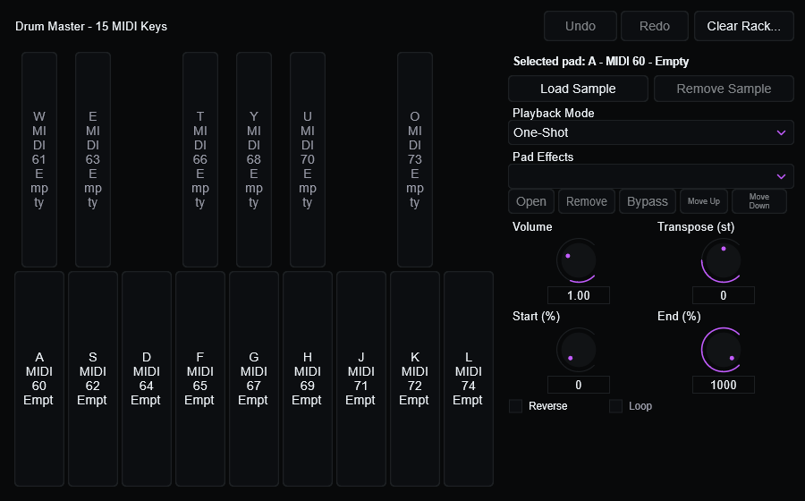
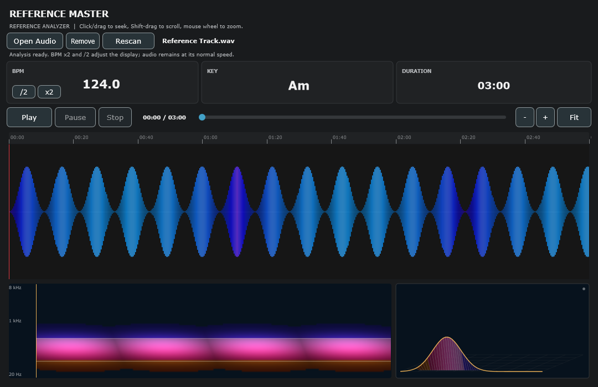
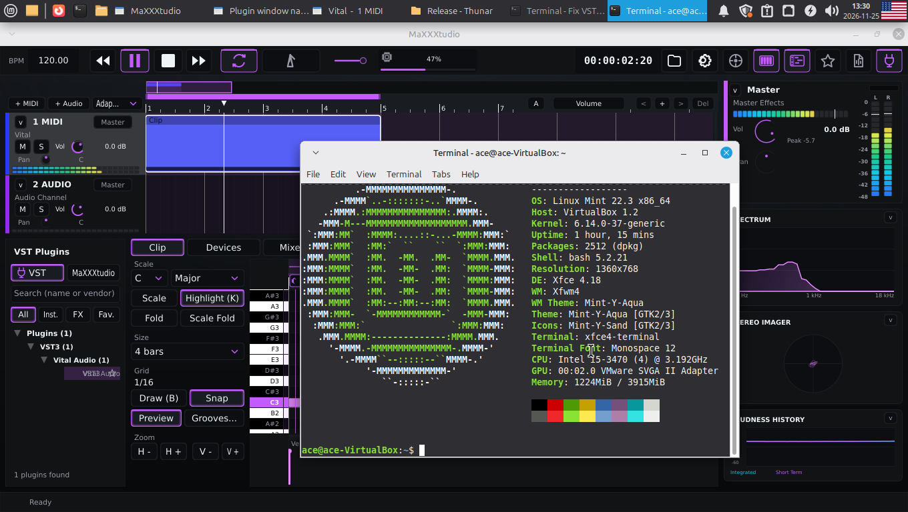

<h1 align="center">MaXXXtudio</h1>

<p align="center">
  A digital audio workstation for creating, arranging, editing, and mixing music.
</p>

MaXXXtudio is a free, open-source, cross-platform DAW built with C++20 and JUCE 8.0.15. Windows and Linux are supported targets, with VST3 hosting on both platforms. macOS has not been validated yet. The application combines an arrangement view, MIDI editing, a mixer, native tools, automation, and a custom interface.

## Current interface

<p align="center">
  
</p>

The main window includes the Arrangement view, plugin browser, mixer, and piano roll. The audio browser and device chain show audio files and VST3 plugins for the selected track.

### Moving plugin windows

This demonstration shows how to move between multiple open plugin windows when screen space is limited. You can minimize a window, but this workflow keeps it visible while you adjust its parameters.

<p align="center">
  <a href="app/assets/readme/demo.mp4">
    
  </a>
</p>

## Implemented features

- **Arrangement:** MIDI and audio tracks, multiple clips, move/copy/duplicate, split, adaptive grid, locators, loop, overview, track collapse/expand, and optional playhead following.
- **Piano roll:** create and edit notes, velocity editing, quantization, selection, scales, Fold, highlighting, MIDI grooves, computer-keyboard input, and horizontal/vertical zoom.
- **Audio editing:** split and join clips, adjust clip edges, fades, transient analysis, and manual Auto-Warp using the detected source BPM. The first analyzed sample can set the project tempo; later samples follow it. Time-stretching is currently limited to Re-Pitch mode, which changes pitch.
- **Selection and shortcuts:** select clips and time ranges, select multiple tracks, copy/cut/paste, duplicate, and group/ungroup tracks.
- **Mixer:** volume, pan, mute, solo, peak meters, master controls, and groups.
- **Automation:** volume, pan, mute, and VST3 parameters with envelopes in the Arrangement.
- **VST3 plugins:** background scanning, favorites, custom folders, isolated worker execution, and project crash recovery.
- **Navigation:** browse plugins by folder, label, and type; browse audio files; color-code favorites; search, preview, and navigate history.
- **MIDI grooves:** import `.agr` files, browse and preview the library, and apply grooves.
- **Native tools:** Drum Master, Volume Master, Comp Master, EQ Master, and Reference Master.
- **Projects:** save and open `.std` files, autosave and recover sessions, undo/redo, and export 24-bit WAV files.
- **Visual identity:** custom themes, control states, tooltips, vector icons, and a neon-accent color palette.

## Native tools

The **MaXXXtudio** browser tab contains instruments and effects developed as part of the project.

<p align="center">
  
</p>

### Native effects and instruments

<table>
  <tr>
    <td align="center" width="50%">
      <br>
      <strong>Drum Master</strong><br>
      15 MIDI sampler pads with One-Shot and Classic modes, pitch and volume controls,
      trim, reverse, loop, and per-pad effects.
    </td>
    <td align="center" width="50%">
      <br>
      <strong>Volume Master</strong><br>
      Stereo width and gain, balance, input modes, mono, phase inversion,
      Bass Mono, and Auto Pan.
    </td>
  </tr>
  <tr>
    <td align="center" width="50%">
      <br>
      <strong>Comp Master</strong><br>
      Compressor with sidechain routing, oscilloscope, input/output meters,
      gain reduction, threshold, ratio, attack, release, knee, and mix controls.
    </td>
    <td align="center" width="50%">
      <br>
      <strong>EQ Master</strong><br>
      Eight-band parametric equalizer with a spectrum analyzer,
      adjustable filters, and Stereo/Midi/Side modes.
    </td>
  </tr>
  <tr>
    <td align="center" width="50%">
      <br>
      <strong>Reference Master</strong><br>
      Track analyzer with waveform, spectrum, estimated BPM/key,
      playback, search, and zoom.
    </td>
    <td width="50%"></td>
  </tr>
</table>

## Build on Windows

Requirements: Windows 10 or 11, CMake 3.22 or later, and Visual Studio with the **Desktop development with C++** workload.

```powershell
cmake -S . -B build
cmake --build build --config Release
```

The executable is created at:

```text
build\app\MaXXXtudio_artefacts\Release\MaXXXtudio.exe
```

Run the tests with:

```powershell
ctest --test-dir build -C Release --output-on-failure
```

In the plugin browser, use **Folders** to add or remove VST3 search paths. These paths are saved in the user configuration.

## Build on Linux

Requirements: a C++20 compiler, CMake 3.22 or later, and the system development libraries required by JUCE.

MaXXXtudio running on Linux Mint with the Vital VST3 plugin detected:

<p align="center">
  
</p>

```bash
cmake -S . -B build -DROLL_BUILD_APP=ON -DROLL_BUILD_TESTS=ON
cmake --build build --config Release --target MaXXXtudio MaXXXtudioPluginWorker
ctest --test-dir build -C Release --output-on-failure
```

The executable is created at:

```text
build/app/MaXXXtudio_artefacts/Release/MaXXXtudio
```

To install the application, plugin worker, desktop launcher, and application icon under `~/.local`:

```bash
cmake --install build --prefix "$HOME/.local" --component Runtime
```

VST3 plugins are searched in the standard Linux locations, including `~/.vst3`, `/usr/lib/vst3`, and `/usr/local/lib/vst3`. Use **Preferences → Plugins VST3** to add another search folder.

## Project structure

```text
core/    Sequencer and platform-independent music logic
tests/   Automated tests
app/     JUCE application, interface, audio, plugins, and production tools
docs/    Detailed project specification
```
