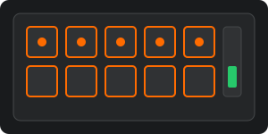

<p align="center">
  
</p>

<h1 align="center">MaXXXtudio</h1>

<p align="center">
  Uma estação de áudio digital para criar, organizar, processar e mixar música.
</p>

O MaXXXtudio é um DAW open source para Windows e Linux, desenvolvido em C++20
com JUCE. O projeto está em evolução e reúne ferramentas essenciais de produção,
instrumentos, efeitos e edição musical em uma interface própria.

## Recursos implementados

- **Arrangement:** trilhas MIDI e áudio, clips, navegação, zoom, grades, locators, loop e transporte.
- **Piano Roll:** criação e edição de notas, velocity, quantização, escalas, fold, grooves e ferramentas de seleção.
- **Edição de áudio:** divisão e união de clips, cortes de borda, fades de entrada e saída, curvas de fade, análise de transientes, Warp, BPM original, ×2 e ÷2.
- **Seleção:** seleção por clique, Shift/Ctrl por faixa de tempo, seleção em várias trilhas e operações sobre a seleção.
- **Mixer:** volume, pan, mute, solo, medição de pico e canal Master.
- **Automação:** envelopes globais para volume, pan, mute e parâmetros de plugins; seleção automática ao tocar um controle.
- **Plugins VST3:** varredura de fabricantes, favoritos, pastas personalizadas, execução isolada e estado salvo no projeto.
- **Navegadores:** arquivos de áudio, favoritos por cor, busca, pré-escuta, histórico e localização no Explorer.
- **Drum Rack:** 16 pads, carregamento de samples, modos One-Shot e Classic, pitch, volume, início, fim, reverso, loop e efeitos por pad.
- **MIDI Learn:** mapeamento de controles MIDI para volume, pan, mute e solo.
- **Teclado MIDI:** execução pelo teclado do computador, oitavas e velocidade.
- **Projetos:** salvar e abrir `.std`, histórico de undo/redo, recuperação e exportação do Master como WAV.
- **Temas:** preto, cinza grafite e branco com laranja; cinza/preto com azul; Matrix 1 e Matrix 2 com verde.
- **Interface:** tooltips acessíveis, ícones vetoriais, estados ativos, hover e texto legível por tema.

## Plugins nativos

<table>
  <tr>
    <td align="center" width="50%">
      <br>
      <strong>Drum Rack</strong><br>
      Instrumento de 16 pads para tocar samples por MIDI. Inclui carga de áudio, volume, pitch,
      trecho inicial/final, reverso, loop, um modo One-Shot e cadeias de efeitos independentes por pad.
    </td>
    <td align="center" width="50%">
      <br>
      <strong>Volume Master</strong><br>
      Utilidade para ganho, largura estéreo, balanceamento, entrada mono/left/right/swap,
      inversão de fase, mono baixo, mute, filtro DC e auto-pan configurável.
    </td>
  </tr>
</table>

## Compilar

Requisitos: CMake 3.22+ e compilador C++20.

**Windows** — com Visual Studio e o componente “Desenvolvimento para desktop com C++”:

```powershell
cmake -S . -B build
cmake --build build --config Release
```

Executável: `build\app\MaXXXtudio_artefacts\Release\MaXXXtudio.exe`

**Linux (Ubuntu/Debian):**

```sh
sudo apt install build-essential cmake ninja-build pkg-config libasound2-dev libfreetype-dev \
  libfontconfig1-dev libx11-dev libxrandr-dev libxinerama-dev libxcursor-dev libxext-dev libgl1-mesa-dev
cmake -S . -B build -G Ninja -DCMAKE_BUILD_TYPE=Release
cmake --build build -j2
```

Execute os testes com:

```sh
ctest --test-dir build -C Release --output-on-failure
```

No navegador de plugins, **Pastas** permite adicionar ou remover diretórios de busca VST3.
Esses caminhos ficam salvos nas configurações do usuário.

## Estrutura

```text
core/    modelo musical e sequenciador
tests/   testes automatizados
app/     aplicativo JUCE, interface, áudio, plugins e ferramentas de produção
```
