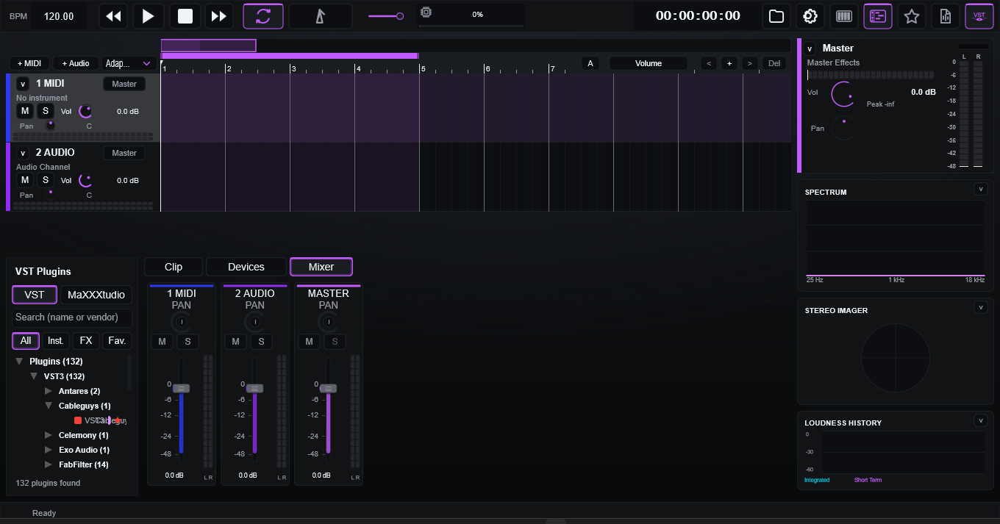
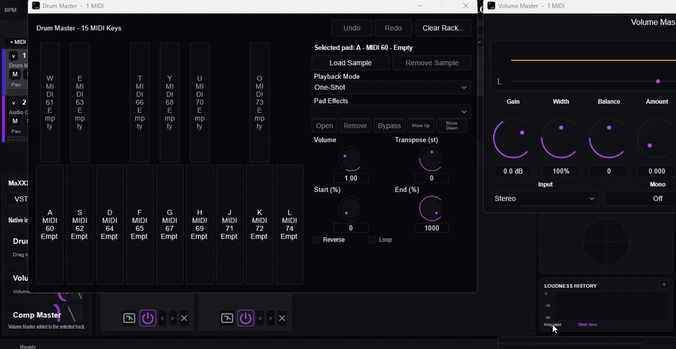
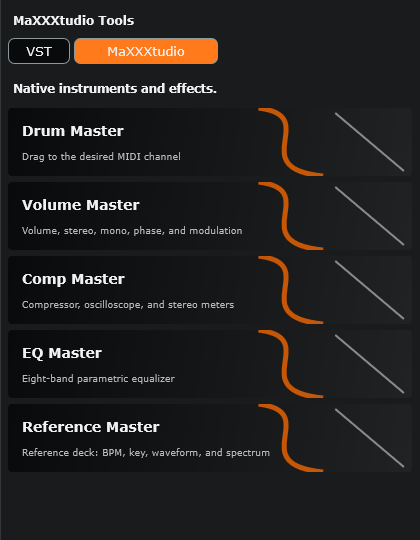
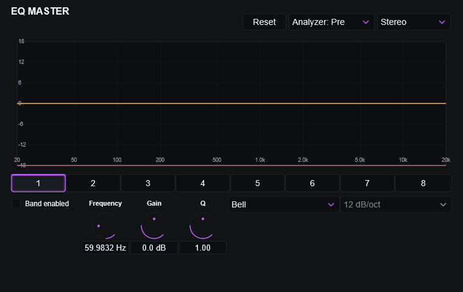

<h1 align="center">MaXXXtudio</h1>

<p align="center">
  Estação de trabalho de áudio digital para criar, organizar, editar e mixar música.
</p>

MaXXXtudio is an open source DAW (Digital Audio Workstation) developed in C++20 and JUCE 8.0.15. At first, it was supposed to be multiplatform (Windows/Linux  — Linux specially. But, as I'm the only developer of this project, it became extremelly difficult test and implement features on both platforms. So I'm wasting all my energy on Windows right now and hoping to have a Linux version sooner.  It combines arrangement view, MIDI edition, VST3 Hosting (only VST3), mixer, native tools, automation and a modern interface.
## Actual interface

<p align="center">
  
</p>

Here we got the Arrangement view, the plugin navigation and the mixer. The main window offers a piano roll too. The audio navigator and device chain  — VST3 that are opened in the selected channel.
### Repositioning a plugin window

This part shows how to navigate through more than one opened plugin at the same time when the user monitor is small. It's possible to minimize, of course, but, as I prefer keep the plugin window visible as I configure it's parameters, it was designed this way.

<p align="center">
  <a href="app/assets/readme/demo.mp4">
    
  </a>
</p>

## Implemented resources

- **Arrangement:** MIDI and Audio tracks, multiple clips, move/copy/duplicate, division, adaptative grid, locators, loop, overview, minimize hide/expand a channel.
- **Piano Roll:** create and edit notes, velocity, quantize, select, scale, Fold,
  Highlight, grooves MIDI, computer keyboard and horizontal/vertical zoom.
- **Audio Edition:** divide and merge clips, adjust edges, fades, transient analysis. The stretch remain limited  at the current Re-Pitch mode.
- **Selection and shortcuts:** entire clip selection, intervals, multiple track selection,
  copy/cut/paste, duplicate, group and ungroup tracks.
- **Mixer:** volume, pan, mute, solo, peak analyzer, master and groups.
- **Automation:** volume, pan, mute and VST3 parameters in global envelopes at the arrangement.
- **VST3 Plugins:** background scanner, favorites, custom folders, isolated worker execution and project crash/close recovery.
- **Navigation:** plugins by folder/label and type, audio files, favorite by colour,
  search, preview, history and localization in the File Explorer.
- **MIDI Grooves:** `.agr` import, library, preview, persistance and application.
- **Native tools:** Drum Master, Volume Master, Comp Master, EQ Master and Reference Master.
- **Projects:** save/open `.std`, autosave with recovery, undo/redo supported and offline master export — WAV 24-bit.
- **Visual identity:** custom themes, active state/hover/disabled, tooltips, vetorial icons, color palete blue/green/red/magenta/cyan and others.

## Native tools

The **MaXXXtudio** navigation tab reunite the instruments and effects developed directly in the project.

<p align="center">
  
</p>

### Native tools

<table>
  <tr>
    <td align="center" width="50%">
      <br>
      <strong>Drum Master</strong><br>
      15 MIDI Sampler pads, with One-Shot/Classic, pitch and volume adjustment,
      end to end cut, reverse, loop and effects per pad.
    </td>
    <td align="center" width="50%">
      <br>
      <strong>Volume Master</strong><br>
      Stereo image and gain control, balance, input modes, mono,
      phase invertion, Bass Mono and Auto Pan.
    </td>
  </tr>
  <tr>
    <td align="center" width="50%">
      <br>
      <strong>Comp Master</strong><br>
      Compressor with sidechain routing, osciloscope, input/output meters
      and gain reduction, threshold, ratio, atack, release, knee and mix.
    </td>
    <td align="center" width="50%">
      <br>
      <strong>EQ Master</strong><br>
      Parametrical eight bands equalizer with spectrum analyzer,
      adjustable filter and Stereo/Midi/Side modes.
    </td>
  </tr>
  <tr>
    <td align="center" width="50%">
      <br>
      <strong>Reference Master</strong><br>
      Track frequency analyzer: waveform, spectrum, BPM/Estimated key,
      reproduction, search and zoom.
    </td>
    <td width="50%"></td>
  </tr>
</table>

## To compile on Windows

Requisites: Windows 10/11, CMake 3.22+ and Visual Studio with **Desktop development with C++**.

```powershell
cmake -S . -B build
cmake --build build --config Release
```

Runner:

```text
build\app\MaXXXtudio_artefacts\Release\MaXXXtudio.exe
```

To run tests:

```powershell
ctest --test-dir build -C Release --output-on-failure
```

In the plugins navigator, **Folders** allows add or remove search VST3 directories. The folders are persisted in the user configuration.

## Project structure

```text
core/    sequencer and pure musical mode
tests/   automatic tests
app/     JUCE aplication, interface, audio, plugins and production tools
docs/    detailed project specification
```
