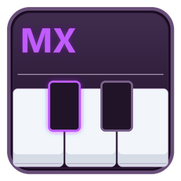
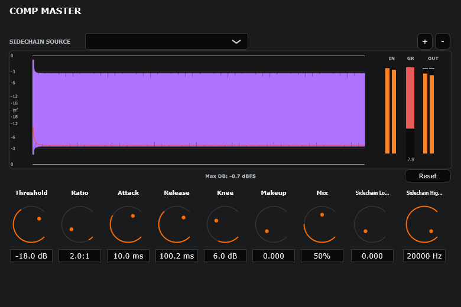

<p align="center">
  
</p>

<h1 align="center">MaXXXtudio</h1>

<p align="center">
  A digital audio workstation for creating, organizing, processing, and mixing music.
</p>

MaXXXtudio is an open-source DAW for Windows, built with C++20 and JUCE.
Linux is not supported at this time; a port may be considered in the future.
The project is evolving and brings essential production tools, instruments, effects,
and music editing together in a custom interface.

## Implemented Features

- **Arrangement:** MIDI and audio tracks, clips, navigation, zoom, grids, locators, loop, and transport.
- **Piano Roll:** create and edit notes, velocity, quantization, scales, fold, grooves, and selection tools.
- **Audio Editing:** split and merge clips, trim edges, fade-in and fade-out curves, transient analysis, Warp, source BPM, ×2, and ÷2.
- **Selection:** click, Shift/Ctrl time-range selection, multi-track selection, and selection operations.
- **Mixer:** volume, pan, mute, solo, peak metering, and Master channel.
- **Automation:** global envelopes for volume, pan, mute, and plugin parameters; automatic parameter selection when adjusting a control.
- **VST3 Plugins:** vendor scanning, favorites, custom folders, isolated execution, and project-saved state.
- **Browsers:** audio files, color-coded favorites, search, preview, history, and File Explorer location.
- **Drum Master:** 15 pads, sample loading, One-Shot and Classic modes, pitch, volume, start, end, reverse, loop, and per-pad effects.
- **MIDI Learn:** map MIDI controls to volume, pan, mute, and solo.
- **Computer MIDI Keyboard:** play from the computer keyboard with octave and velocity controls.
- **Projects:** save and open `.std` files, undo/redo history, recovery, and Master WAV export.
- **Themes:** graphite/black with orange, blue, or red; white with orange; Matrix 1 and Matrix 2 with green.
- **Interface:** accessible tooltips, vector icons, active and hover states, and theme-aware readable text.

## Native Tools tab

The plugin browser's **MaXXXtudio** tab groups the built-in instruments and effects in one place.

<p align="center">
  
</p>

## Native Plugins

<table>
  <tr>
    <td align="center" width="50%">
      <br>
      <strong>Drum Master</strong><br>
      A 15-pad instrument for playing samples over MIDI. Includes audio loading, volume, pitch,
      start/end positions, reverse, loop, One-Shot mode, and independent effect chains per pad.
    </td>
    <td align="center" width="50%">
      <br>
      <strong>Volume Master</strong><br>
      A utility for gain, stereo width, balance, mono/left/right/swap input, phase inversion,
      and configurable auto-pan.
    </td>
  </tr>
  <tr>
    <td align="center" width="50%">
      <br>
      <strong>Comp Master</strong><br>
      A compressor with sidechain routing, live waveform and gain-reduction display,
      stereo input/output meters, and threshold, ratio, timing, and mix controls.
    </td>
    <td align="center" width="50%">
      <br>
      <strong>EQ Master</strong><br>
      An eight-band parametric equalizer with a live spectrum analyzer, selectable filter
      shapes, and Stereo, Mid, and Side processing modes.
    </td>
  </tr>
  <tr>
    <td align="center" width="50%">
      <br>
      <strong>Reference Master</strong><br>
      A reference-track deck with waveform and spectrum analysis, BPM/key estimates,
      playback, seeking, and zoom controls.
    </td>
    <td width="50%"></td>
  </tr>
</table>

## Build

Requirements: Windows, CMake 3.22+, and Visual Studio with the “Desktop development with C++” workload.

```powershell
cmake -S . -B build
cmake --build build --config Release
```

Executable: `build\app\MaXXXtudio_artefacts\Release\MaXXXtudio.exe`

Run the tests with:

```powershell
ctest --test-dir build -C Release --output-on-failure
```

In the plugin browser, **Folders** lets you add or remove VST3 search directories.
These paths are saved in the user settings.

## Project Structure

```text
core/    music model and sequencer
tests/   automated tests
app/     JUCE application, interface, audio, plugins, and production tools
```
